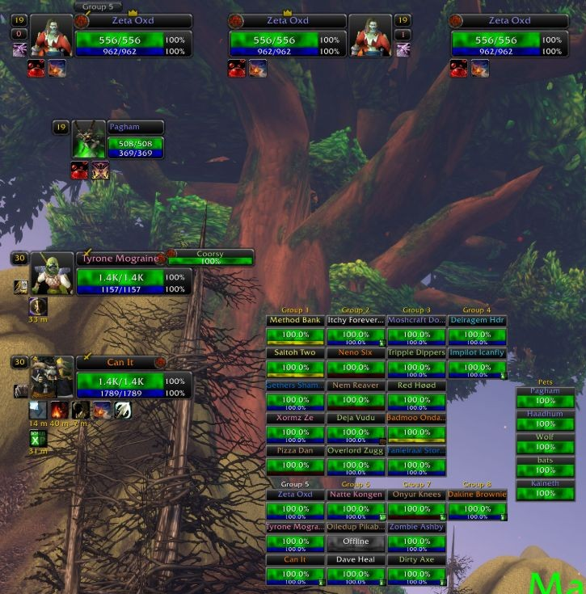

# F-Perl

Unit frames for World of Warcraft: Forever: player, pet, target, focus, target of target, party, party pets and raid. F-Perl keeps the look of the classic X-Perl unit frames, rebuilt for the Forever client. Three optional raid tools come with it: Raid Admin, Raid Helper and Raid Monitor.

## What F-Perl does differently

- Auras are drawn by the game's own aura display, so buffs and debuffs keep showing in content where the game hides aura details from addons.
- Light on the game: frames update when the game reports a change, not by checking on a timer, and no setting or event redraws every frame when only one part changed.
- A new settings system, built into the game's settings panel: every option in one place, one page per frame group, and changes take effect at once (only switching the Player, Pet or Target frame on or off needs `/reload`).
- Layouts: named sets of positions and settings, shared by all your characters, switched in the options or with `/fperl layout <name>`.
- A new unlock mode: unlocking hides the options and shows a small toolbar with an alignment grid and snapping, and a right-click on any frame opens a menu of its common settings. Changing a frame's scale keeps it where it is.
- Automatic range fading: F-Perl picks your longest-range spells from your spellbook, so out-of-range units fade without any setup for your class.

## Install

1. Download the zip from the latest release on this repository's Releases page.
2. Unpack it into `World of Warcraft\_classic_beta_\Interface\AddOns`. You get four folders: `FPerl`, `FPerl_RaidAdmin`, `FPerl_RaidHelper` and `FPerl_RaidMonitor`. `FPerl` is the unit frames; the other three are the raid tools, which need `FPerl` and can be left out.
3. Start the game, or restart it if it was running.

## Use

- Open the options with `/fperl` or a left click on the F-Perl minimap button. They are in the game's settings panel under F-Perl, one page per frame group.
- To move frames, unlock them (`/fperl unlock`, or General > Frames > Unlock frames), drag them, then lock them again (`/fperl lock`).
- The Player, Pet and Target frames can each be switched off in General > Frames, which leaves Blizzard's own frame in place. The change takes effect after `/reload`.
- A layout is a named set of positions and settings. Switch layouts in the options or with `/fperl layout <name>`.
- Right-drag the minimap button to move it; right-click it for a short menu.

## Slash commands

F-Perl:

| Command | What it does |
|---|---|
| `/fperl` | Opens the options (also `/fperl menu` and `/fperl options`). |
| `/fperl unlock` | Unlocks the frames so they can be dragged. |
| `/fperl lock` | Locks the frames in place. |
| `/fperl layout` | Lists the layouts and marks the current one. |
| `/fperl layout <name>` | Switches to that layout. |

Raid Admin:

| Command | What it does |
|---|---|
| `/rad` or `/fpadmin` | Opens the Raid Admin window. |
| `/rad save [name]` | Saves the raid's group arrangement under that name (the game time if no name is given). |
| `/rad load <name>` | Moves raid members back into the groups of that saved arrangement. |
| `/rad auto` | Turns on or off showing the Raid Admin window when you are raid leader or assistant. |
| `/raitem <item>` or `/fpitem <item>` | Asks the raid who carries that item. |
| `/radur` | Asks the raid for equipment durability. |
| `/raresist` or `/raresists` | Asks the raid for resistances. |
| `/rareg` | Asks the raid for reagents. |

The `/raitem`, `/radur`, `/raresist` and `/rareg` checks open the Item Check window; raid members reply when their raid addon answers CT_RaidAssist queries.

Raid Helper:

| Command | What it does |
|---|---|
| `/fphelper assists` | Opens the assists view. |
| `/fphelper raid` | Opens the Raid Helper (main tank targets). |
| `/fphelper alpha raid <value>` | Sets the transparency of the Raid Helper window. |
| `/fphelper alpha assists <value>` | Sets the transparency of the assists view. |
| `/fphelper ctra` | Turns on or off the use of CT_RaidAssist main tank targets. |

Subcommands can be shortened: `/fphelper as` is `/fphelper assists`. Raid Monitor has no slash command.

## Known issues

- The raid tools have not yet been reviewed for Forever.
- Raid Helper: healer mode cannot be turned on.
- Raid Helper: the `/fphelper` usage line lists `find` and `scale`, which do nothing.
- In a vehicle, a click on the Player frame's name or portrait targets you, not the vehicle.

## Reporting bugs

Open an issue at https://github.com/Zeta0xD/FPerl/issues with what you did, what you saw, and the F-Perl version you downloaded. For a Lua error, turn error display on once with `/console scriptErrors 1` and copy the full error text into the issue.

## Credits and license

F-Perl is by Zeta0xD, built for World of Warcraft: Forever in 2026. It started from the code of X-Perl UnitFrames | Revived, a continuation of Z-Perl and X-Perl, and has been rebuilt since: the settings panel, named layouts, frame arranging and the code's structure and names are new. The earlier versions are the work of Ziliya, Resike, Halfdays, Zek and Nymbia; F-Perl is a modified version of their work.

Released under the GNU General Public License v3 (`LICENSE`), with no warranty. Source files that carry code from the earlier versions keep their original author and license lines.
