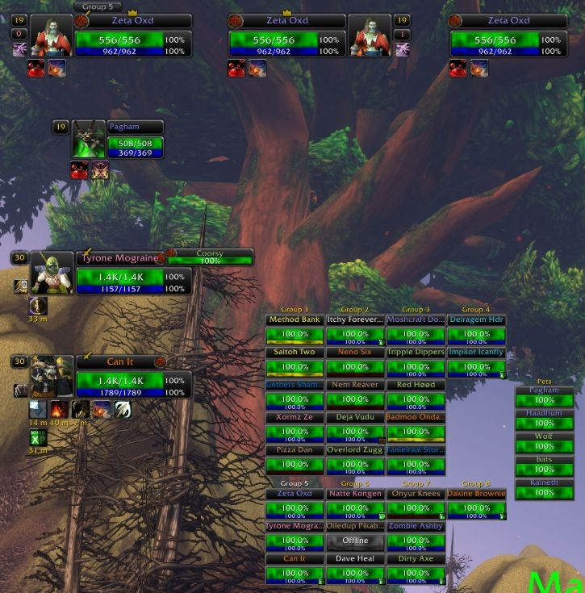

# F-Perl

Unit frames for World of Warcraft: Forever: player, pet, target, focus, target of target, party, party pets and raid. F-Perl keeps the look of the classic X-Perl unit frames, rebuilt for the Forever client. Three optional raid tools come with it: Raid Admin, Raid Helper and Raid Monitor.

Changes in each version: https://github.com/Zeta0xD/FPerl/blob/main/CHANGELOG.md

## What F-Perl does differently

- Auras are drawn by the game's own aura display, so buffs and debuffs keep showing in content where the game hides aura details from addons.
- Light on the game: frames update when the game reports a change, not by checking on a timer, and no setting or event redraws every frame when only one part changed.
- A new options window: every option in one place, one tab per frame group, basic options first, search across all tabs, and changes take effect at once (only switching the Player, Pet or Target frame on or off needs `/reload`).
- Layouts: named sets of positions and settings, shared by all your characters, switched in the options or with `/fperl layout <name>`.
- A new unlock mode: unlocking shows a small toolbar with an alignment grid and snapping, and a click on any frame opens a popup of its common settings. Changing a frame's scale keeps it where it is.
- Automatic range fading: F-Perl picks your longest-range spells from your spellbook, so out-of-range units fade without any setup for your class.

## Install

1. Install F-Perl with the CurseForge app, or download the zip from CurseForge or from the latest release at https://github.com/Zeta0xD/FPerl/releases.
2. Unpack the zip into `World of Warcraft\_forever_\Interface\AddOns`. You get four folders: `FPerl`, `FPerl_RaidAdmin`, `FPerl_RaidHelper` and `FPerl_RaidMonitor`. `FPerl` is the unit frames; the other three are the raid tools, which need `FPerl` and can be left out.
3. Start the game, or restart it if it was running.

## Use

- Open the options with `/fperl`, a left click on the F-Perl minimap button, or the Open button on F-Perl's page in the game's settings panel. The window has one tab per frame group. It shows the basic options; tick Show advanced options for the rest. The search box finds an option on any tab. An option that has no effect until another is on is greyed. Options cannot be changed in combat. An option that needs `/reload` is marked, with a Reload button. The window remembers its position and tab.
- To move frames, unlock them (`/fperl unlock`, or General > Frames > Unlock frames and hide menu), drag them, then lock them again (`/fperl lock`). While unlocked, click a frame without dragging to open a popup with that frame's basic options, an All settings button that opens its tab, and a Lock button.
- To move a frame's buffs and debuffs, unlock the frames and drag the aura blocks (the blue Buffs and Debuffs boxes), or set Buff X / Y and Debuff X / Y under Show advanced options. Both work on every frame, raid frames included.
- Right-click one of your buffs on the Player frame to remove it.
- Weapon enchants (rogue poisons, oils, sharpening stones) show first in the Player frame's buff line, with time left and charges, and the buffs move over while one is on; right-click one to remove it. Player > Auras > Weapon enchants switches them off. With debuffs set nearer the frame than buffs on the same side, the enchants sit left of the frame instead.
- Hit indicators (the damage and healing numbers on a frame) show with or without the portrait. The Hit text position option puts them on the portrait's spot or on the name.
- The Player, Pet and Target frames can each be switched off in General > Frames, which leaves Blizzard's own frame in place. The change takes effect after `/reload`.
- A layout is a named set of positions and settings. Switch layouts in the options or with `/fperl layout <name>`.
- Right-drag the minimap button to move it; right-click it for a short menu.

## Slash commands

F-Perl:

| Command | What it does |
|---|---|
| `/fperl` | Opens the options (also `/fperl menu` and `/fperl options`). |
| `/fperl unlock` | Unlocks the frames so they can be dragged. |
| `/fperl lock` | Locks the frames in place. |
| `/fperl layout` | Lists the layouts and marks the current one. |
| `/fperl layout <name>` | Switches to that layout. |

Raid Admin:

| Command | What it does |
|---|---|
| `/rad` or `/fpadmin` | Opens the Raid Admin window. |
| `/rad save [name]` | Saves the raid's group arrangement under that name (the game time if no name is given). |
| `/rad load <name>` | Moves raid members back into the groups of that saved arrangement. |
| `/rad auto` | Turns on or off showing the Raid Admin window when you are raid leader or assistant. |
| `/raitem <item>` or `/fpitem <item>` | Asks the raid who carries that item. |
| `/radur` | Asks the raid for equipment durability. |
| `/raresist` or `/raresists` | Asks the raid for resistances. |
| `/rareg` | Asks the raid for reagents. |

The `/raitem`, `/radur`, `/raresist` and `/rareg` checks open the Item Check window; raid members reply when their raid addon answers CT_RaidAssist queries.

Raid Helper:

| Command | What it does |
|---|---|
| `/fphelper assists` | Opens the assists view. |
| `/fphelper raid` | Opens the Raid Helper (main tank targets). |
| `/fphelper alpha raid <value>` | Sets the transparency of the Raid Helper window. |
| `/fphelper alpha assists <value>` | Sets the transparency of the assists view. |
| `/fphelper ctra` | Turns on or off the use of CT_RaidAssist main tank targets. |

Subcommands can be shortened: `/fphelper as` is `/fphelper assists`. Raid Monitor has no slash command.

## Known issues

- The raid tools have not yet been reviewed for Forever.
- Raid Helper: healer mode cannot be turned on.
- In a vehicle, a click on the Player frame's name or portrait targets you, not the vehicle.

## Reporting bugs

Open an issue at https://github.com/Zeta0xD/FPerl/issues with what you did, what you saw, and the F-Perl version you downloaded. For a Lua error, turn error display on once with `/console scriptErrors 1` and copy the full error text into the issue.

## Credits and license

F-Perl is by Zeta0xD, built for World of Warcraft: Forever in 2026. It started from the code of X-Perl UnitFrames | Revived, a continuation of Z-Perl and X-Perl, and has been rebuilt since: the options window, named layouts, frame arranging and the code's structure and names are new. The earlier versions are the work of Ziliya, Resike, Halfdays, Zek and Nymbia; F-Perl is a modified version of their work.

Released under the GNU General Public License v3 (`LICENSE`), with no warranty. Source files that carry code from the earlier versions keep their original author and license lines.
